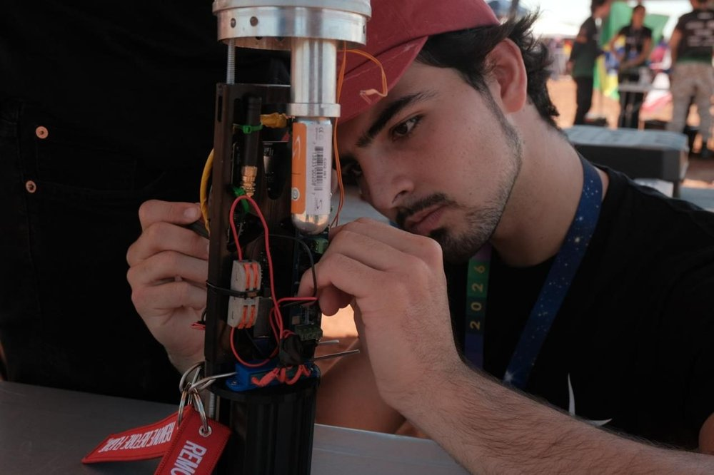
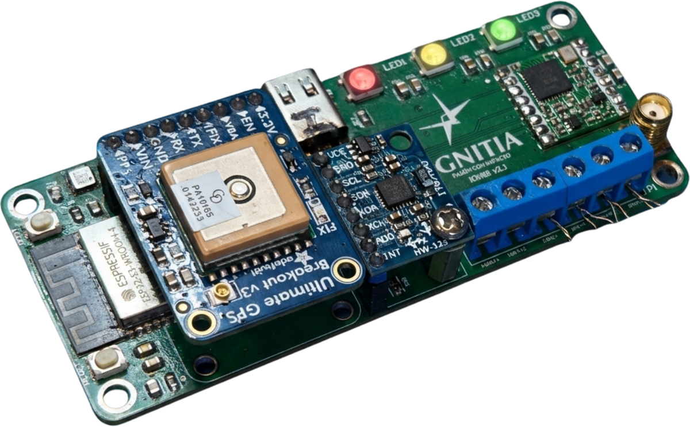

  <a href="https://emilio-guadarrama-portfolio.vercel.app">
    <picture>
      <source media="(prefers-color-scheme: dark)" srcset="assets/header-dark.svg">
      <source media="(prefers-color-scheme: light)" srcset="assets/header-light.svg">
      
    </picture>
  </a>

  
  
  
  

I'm an electronics student at Tec de Monterrey. On Ignitia Rocket Lab I design the flight computers for our rockets: schematics, PCB layout, bring-up on the bench, and going through the flight logs afterwards to see what happened.

## Now

<table>
  <tr>
    <td valign="top">

- Vice President and Electronics & Avionics Lead at [Ignitia Rocket Lab](https://ignitia.space). The team has 30 members and I lead the 9 in electronics.
- Flew at LASC 2026 in Brazil: 9th of 25 in the Rocket Challenge (1 km), and 9th of 50 in the Satellite Challenge, where I was CanSat Mission Leader.
- Working on the IGNIS flight computer and its MAGNIS ground station.
- Studying Electronics and Semiconductor Engineering, class of 2029.
- Before university I spent three seasons in FIRST Robotics with Team Daedalus 7102, starting as a technician and ending as Mechanical Lead.

</td>
    <td width="38%" valign="top">
       
      Final avionics-bay integration · LASC 2026
    </td>
  </tr>
</table>

---

## IGNIS flight computer

<table>
  <tr>
    <td width="46%" valign="top">
      
    </td>
    <td valign="top">

The flight computer for our student rockets. It detects apogee, fires the recovery charges, sends telemetry over LoRa and logs the whole flight to an SD card.

`ESP32-S3` `RFM95W LoRa 915 MHz` `GNSS` `IMU` `Barometer` `2× pyro` `4-layer PCB`

- v2.2 was the primary flight computer at LASC 2026.
- I went through the flight logs in Python to check the apogee detection and the telemetry.
- We lost a lot of telemetry packets, and that is why I built MAGNIS, a ground station with two antennas.
- v5 is a redesign that JLCPCB can assemble for us: all SMD parts on a Ø75 mm board.

Repos: [IGNIS v2](https://github.com/IgnitiaRocketLab/IGNIS-v2-FlightComputer) · [IGNIS v5](https://github.com/Emilio-Guadarrama/IGNIS-v5-FlightComputer) · [MAGNIS ground station](https://github.com/Emilio-Guadarrama/MAGNIS-v1-GroundStation)

</td>
  </tr>
</table>

<b>Revision history v1 → v5</b>

| Rev | Status |
|---|---|
| `v1` | Fabricated; too large for the rocket, redesigned before assembly |
| `v2` | First assembled; bring-up found schematic errors |
| `v2.2` | Corrected revision; primary flight computer at LASC 2026 |
| `v3` | Incremental update; never fabricated |
| `v4` | Two units built; halted by part availability and a USB-C net error |
| `v5` | Redesigned around parts that are in stock; all SMD, turnkey assembly, Ø75 mm board |

---

## Other projects

<table>
  <tr>
    <td width="33%" valign="top">

**[IGNIS v5](https://github.com/Emilio-Guadarrama/IGNIS-v5-FlightComputer)**

Redesign for turnkey assembly at JLCPCB: 109 placements and 40 BOM lines, 37 of which a Mexican distributor also stocks.

`SAM-M10Q` `LSM6DSV32X` `DPS368`

</td>
    <td width="33%" valign="top">

**[MAGNIS v1](https://github.com/Emilio-Guadarrama/MAGNIS-v1-GroundStation)**

Ground station for IGNIS. It listens with two LoRa receivers at once, logs to microSD, and shows live data on a laptop over USB or on a phone over Wi-Fi.

`2× RFM95W` `ESP32` `2-layer PCB`

</td>
    <td width="33%" valign="top">

**[Portfolio](https://emilio-guadarrama-portfolio.vercel.app)**

My portfolio site, in English and Spanish.

`React` `Vite` `Tailwind CSS`

</td>
  </tr>
</table>

---

## Tools

| Area | Tools |
|---|---|
| **Hardware & PCB** | Altium Designer · KiCad · Schematic capture · 4-layer layout · RF layout · Power distribution · BOM management |
| **Embedded** | ESP32-S3 · C/C++ · Arduino · SPI · I2C · UART · USB · LoRa · GNSS · Sensor integration |
| **Lab & Test** | Oscilloscope · Signal generator · Bench supply · Board bring-up · Failure analysis |
| **Manufacturing** | DFM for turnkey SMT (JLCPCB/LCSC) · Stencil printing · Reflow · Hot-air rework |
| **Software** | Python (pandas, PySide6) · Verilog · LTspice · NI Multisim · Git |

  
  
  
  
  
  
  

---

## Highlights

- LASC 2026, Brazil: 9th of 25 in the Rocket Challenge (1 km), 9th of 50 in the Satellite Challenge
- ENMICE 2025: 2nd place in the project presentation (WIRIKUTA 1.1 test bench)
- Tec de Monterrey Engineering Expo 2025: 1st place, Physical Prototype
- FIRST World Championship 2024: qualified by winning the Hermosillo Regional

  <a href="https://emilio-guadarrama-portfolio.vercel.app">
    <picture>
      <source media="(prefers-color-scheme: dark)" srcset="assets/footer-dark.svg">
      <source media="(prefers-color-scheme: light)" srcset="assets/footer-light.svg">
      
    </picture>
  </a>

