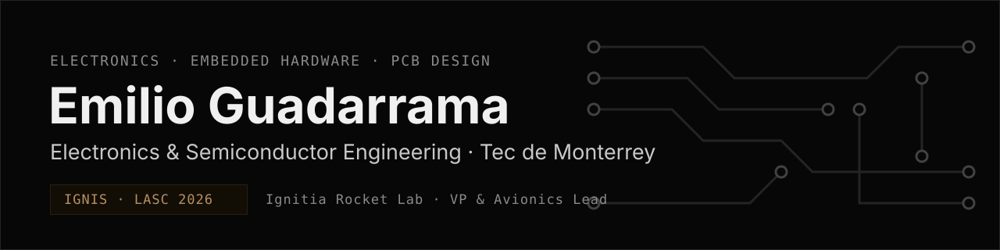
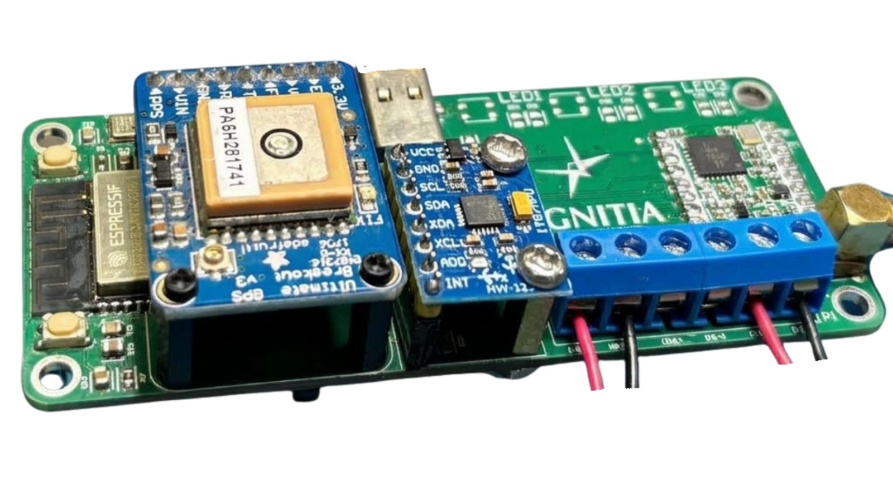

<picture>
  <source media="(prefers-color-scheme: dark)" srcset="assets/banner-dark.svg">
  <source media="(prefers-color-scheme: light)" srcset="assets/banner-light.svg">
  
</picture>

  
  
  
  

I design, build and fly **rocket flight computers** — from multilayer PCB layout to lab bring-up, flight testing and failure analysis.

- 🎓 **B.S. Electronics and Semiconductor Engineering**, Tecnológico de Monterrey, Campus Guadalajara (2025 – 2029)
- 🚀 **Vice President & Electronics & Avionics Lead** at [Ignitia Rocket Lab](https://ignitia.space), a 30-member student rocketry team
- 🛠️ Lead hardware designer of **IGNIS**, an open-source flight computer flown at **LASC 2026** in Brazil
- 🤖 Before university: three seasons of **FIRST Robotics** (Team Daedalus 7102), from technician to Mechanical Lead

---

## 🔥 Featured — IGNIS Flight Computer

<table>
  <tr>
    <td width="46%" valign="top">
      
    </td>
    <td valign="top">

Custom flight computer for student rocketry: it senses the flight, detects apogee in real time, fires the recovery charges, streams LoRa telemetry and logs every sample.

`ESP32-S3` `RFM95W LoRa 915 MHz` `GNSS` `IMU` `Barometer` `2× pyro` `4-layer PCB`

- **v2.2** — primary flight computer at **LASC 2026**
- **188 ms** barometric apogee-detection latency, measured from flight logs
- **40.2 %** telemetry packet loss traced → dual-antenna ground station
- **v5** — all-SMD, turnkey JLCPCB assembly, Ø75 mm board

**Repos →** [IGNIS v2](https://github.com/IgnitiaRocketLab/IGNIS-v2-FlightComputer) · [IGNIS v5](https://github.com/Emilio-Guadarrama/IGNIS-v5-FlightComputer)

</td>
  </tr>
</table>

<b>Revision history v1 → v5</b>

| Rev | Status |
|---|---|
| `v1` | Fabricated; too large for the rocket, redesigned before assembly |
| `v2` | First assembled; bring-up found schematic errors |
| `v2.2` | Corrected revision; **primary flight computer at LASC 2026** |
| `v3` | Incremental update; never fabricated |
| `v4` | Two units built; halted by part availability and a USB-C net error |
| `v5` | Sourcing-first, all-SMD, turnkey; Ø75 mm board |

---

## 🧰 Toolbox

| Area | Tools |
|---|---|
| **Hardware & PCB** | Altium Designer · KiCad · Schematic capture · 4-layer layout · RF layout · Power distribution · BOM management |
| **Embedded** | ESP32-S3 · C/C++ · Arduino · SPI · I2C · UART · USB · LoRa · GNSS · Sensor integration |
| **Lab & Test** | Oscilloscope · Signal generator · Bench supply · Board bring-up · Failure analysis |
| **Manufacturing** | DFM for turnkey SMT (JLCPCB/LCSC) · Stencil printing · Reflow · Hot-air rework |
| **Software** | Python (pandas, PySide6) · Verilog · LTspice · NI Multisim · Git |

  
  
  
  
  
  
  

---

## 🏆 Highlights

- **LASC 2026** · Brazil — 9th of 25, Rocket Challenge (1 km) · 9th of 50, Satellite Challenge as CanSat Mission Leader
- **ENMICE 2025** — 2nd place, project presentation (WIRIKUTA 1.1 test bench)
- **Tec de Monterrey Engineering Expo 2025** — 1st place, Physical Prototype
- **FIRST World Championship 2024** — qualified by winning the Hermosillo Regional

---

  Mexico · Spanish · English (C1) · German (Elementary)

